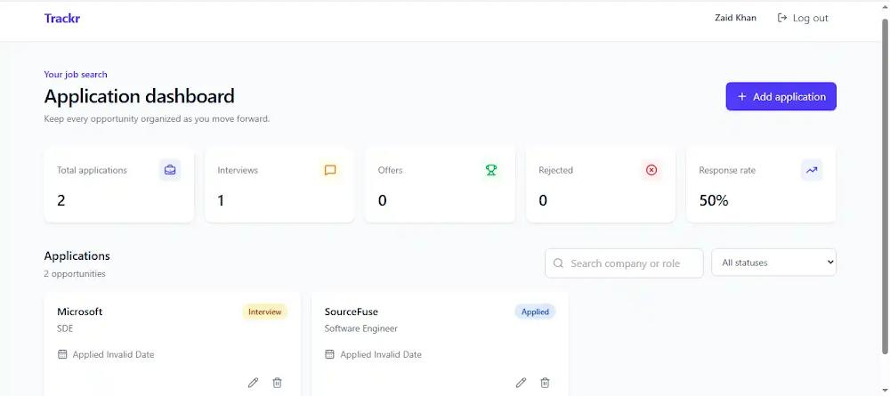
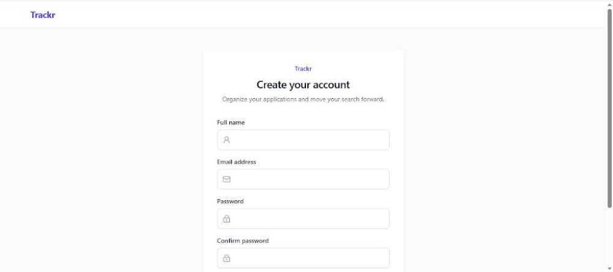
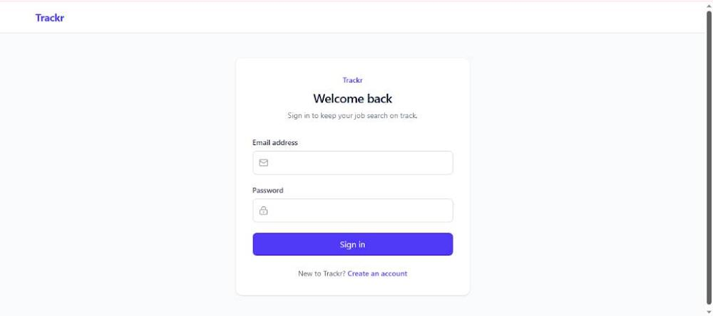
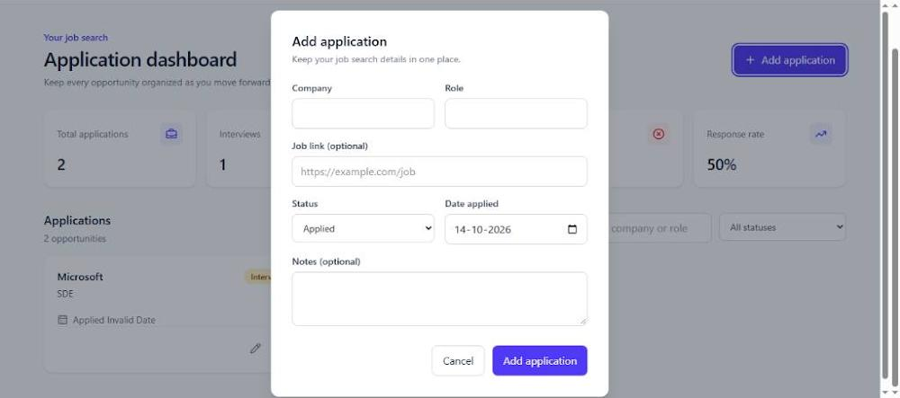

# Trackr — Job Application Tracker

Trackr is a full-stack MERN application that helps job seekers organize and manage their job search in one place. Users can manage job applications, track application statuses, and monitor their progress through a centralized dashboard.

## Live Demo

- **Frontend:** https://trackr-sigma.vercel.app/
- **Backend:** https://trackr-backend-xuy0.onrender.com/
- Note: The backend root URL may return a route-not-found response because the API is not intended to serve a frontend page. Use the API endpoints documented below.

## Features

### Authentication
- User registration and login
- JWT-based authentication
- Password hashing
- Protected routes and user-specific data access

### Job Application Management
- Create, view, update, and delete applications
- Store company name, job role, application status, application date, job link, and notes
- Track applications through four statuses:
  - Applied
  - Interview
  - Offer
  - Rejected

### Dashboard
- View application statistics
- Search applications by supported search fields
- Filter applications by status
- Browse applications using pagination
- Responsive user interface

## Tech Stack

### Frontend
- React
- Vite
- Tailwind CSS
- React Router
- Axios
- Lucide React

### Backend
- Node.js
- Express.js
- MongoDB
- Mongoose
- JSON Web Tokens (JWT)
- bcryptjs
- express-validator

### Deployment
- Vercel — Frontend
- Render — Backend
- MongoDB Atlas — Database, if configured

## Project Structure

```text
Trackr/
├── client/
│   ├── src/
│   │   ├── api/
│   │   ├── components/
│   │   ├── context/
│   │   ├── pages/
│   │   └── ...
│   ├── public/
│   ├── package.json
│   └── ...
├── server/
│   ├── config/
│   ├── controllers/
│   ├── middleware/
│   ├── models/
│   ├── routes/
│   ├── server.js
│   └── package.json
├── screenshots/
│   ├── dashboard.png
│   ├── login.png
│   └── application-form.png
└── README.md
```

## Getting Started

### Prerequisites

- Node.js and npm
- MongoDB local instance or MongoDB Atlas account
- Git

### 1. Clone the Repository

```bash
git clone https://github.com/Zaid-khan01/Trackr
cd Trackr
```

### 2. Configure and Run the Backend

```bash
cd server
npm install
```

Create a `.env` file inside the `server` directory:

```env
PORT=5000
MONGO_URI=your_mongodb_connection_string
JWT_SECRET=your_long_random_secret
CLIENT_URL=http://localhost:5173
```

Replace the example values with your actual configuration. Never commit your `.env` file or expose real credentials.

Start the backend in development mode:

```bash
npm run dev
```

For production:

```bash
npm start
```

The backend runs on the configured port, which is `5000` in the example above.

### 3. Configure and Run the Frontend

Open a separate terminal from the project root:

```bash
cd client
npm install
```

Create a `.env` file inside the `client` directory:

```env
VITE_API_URL=http://localhost:5000/api
```

Start the frontend:

```bash
npm run dev
```

Open the local URL shown in the terminal by Vite.

## Environment Variables

| Variable | Description |
|---|---|
| `PORT` | Backend server port |
| `MONGO_URI` | MongoDB connection string |
| `JWT_SECRET` | Secret used to sign and verify JWTs |
| `CLIENT_URL` | Frontend origin allowed by CORS |
| `VITE_API_URL` | Backend API base URL used by the frontend |

For deployment, configure environment variables in Render and Vercel as appropriate.

- Set `CLIENT_URL` to your deployed frontend origin, without a trailing slash.
- Set `VITE_API_URL` to your deployed backend URL ending in `/api`.
- Keep database credentials and JWT secrets private.
- Remember that Vite environment variables are included in the client build; never put secrets in `VITE_` variables.

## API Endpoints

All API endpoints use `/api` as the base path.

### Authentication

| Method | Endpoint | Description |
|---|---|---|
| POST | `/api/auth/register` | Register a new user |
| POST | `/api/auth/login` | Authenticate a user |
| GET | `/api/auth/me` | Get the authenticated user's profile |

### Applications

| Method | Endpoint | Description |
|---|---|---|
| GET | `/api/applications` | Retrieve applications with supported filters and pagination |
| GET | `/api/applications/stats` | Retrieve dashboard statistics |
| POST | `/api/applications` | Create a new application |
| PUT | `/api/applications/:id` | Update an application |
| DELETE | `/api/applications/:id` | Delete an application |

Protected endpoints require a valid JWT bearer token. Application operations are restricted to the authenticated user's records.

> Verify the endpoint paths and methods against the route files before submitting the repository.

## Validation and Error Handling

- Request validation using `express-validator`
- Password hashing before storage
- JWT authentication middleware
- Centralized API error handling
- User-specific application access

## Screenshots

Add screenshots captured from the actual running application to the `screenshots/` directory.

### Dashboard



### Register



### Login



### Application Form



## AI Development Experience

I used Code0 as an AI-assisted development tool while building Trackr, a job application tracking platform.

Here are some of the ways I used Code0 during development:

1. **API Integration:** Used Code0 to help connect frontend API calls with backend endpoints and ensure data was exchanged correctly.
2. **Component Development:** Used Code0 to build and refine React components, including UI elements used across the application.
3. **Authentication Integration:** Used Code0 to help integrate the frontend authentication flow with backend login and registration endpoints.
4. **Debugging:** Used Code0 to identify and troubleshoot API integration issues and runtime errors during development.
5. **Code Review:** Used Code0 to review implementation details, improve code clarity, and make the application easier to maintain.

Code0 helped me work through implementation challenges more efficiently while I remained involved in integrating, testing, and refining the application.
